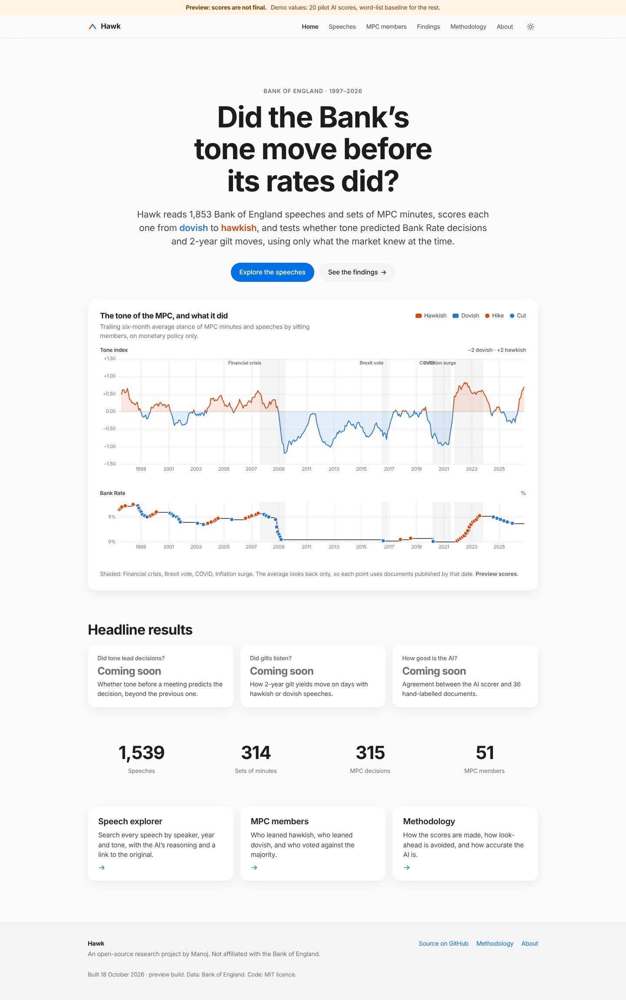

# hawk

Scoring 28 years of Bank of England speeches from hawkish to dovish, and testing whether tone predicted rate moves.

Hawk collects every Bank of England speech and every set of Monetary Policy Committee (MPC)
minutes since 1997, scores each one on a scale from −2 (very dovish) to +2 (very hawkish),
and asks a simple markets question: **did the tone of BoE communication shift before rate
decisions, and did 2-year gilt yields react to tone beyond what the decision itself
explains?** See [PLAN.md](PLAN.md) for the full plan.

## Status

| Step | State |
| --- | --- |
| Speech and minutes collector | ✅ built (`src/hawk/speeches/`) |
| Market data (Bank Rate, gilt yields) | in progress (`src/hawk/market/`) |
| Tone scoring (word list + LLM) | ✅ built, piloted (`src/hawk/scoring/`); full corpus not yet scored |
| Hand labels for evaluation | tool ready (`labelling/`) |
| Website | ✅ built, preview mode until scores are final (`src/hawk/site/`) |
| Analysis | planned |

## Install

Requires Python 3.11 or newer.

```bash
git clone https://github.com/manoselvaks/hawk.git
cd hawk
python -m venv .venv && source .venv/bin/activate
pip install -e ".[dev]"
```

## Collect the speeches and minutes

```bash
python -m hawk.speeches.collect                                  # full rebuild
python -m hawk.speeches.collect --limit-speeches 20 --limit-minutes 10   # quick smoke run
```

(or `make collect` / `make collect-sample`). This writes `data/speeches.parquet` and
`data/minutes.parquet` (1,544 speeches and 315 sets of minutes in the committed build);
see [data/README.md](data/README.md) for the fields, per-year counts and known gaps.

The collector is built to be a good citizen of the BoE website:

- it identifies itself with a `User-Agent` that links back to this repository;
- it reads `robots.txt` first, obeys it (including any `Crawl-delay`), and discovers pages
  from the sitemaps listed there;
- it waits at least one second between requests (`--min-interval` to slow it further);
- every download is cached in `data/raw/` (gitignored), so an interrupted run can simply be
  restarted and will pick up where it left off without re-downloading anything.

Older speeches and minutes are often short web pages that link to a PDF; when a page has
little text and links to a PDF, the PDF's text is used instead.

## Score tone

Each document gets a **relevance** (0–1: is it about monetary policy?) and a **stance**
(−2 very dovish to +2 very hawkish), from two scorers: a transparent word-list baseline
and an LLM through OpenRouter. See [docs/methodology.md](docs/methodology.md) for the
design, and [docs/pilot.md](docs/pilot.md) for the model comparison.

```bash
python -m hawk.scoring.pilot                       # compare candidate models on 20 documents
python -m hawk.scoring.make_labelling_set          # build labelling/label.html
python -m hawk.scoring.evaluate --labels labelling/labels.csv   # scorers vs hand labels
python -m hawk.scoring.score_all                   # prints the cost estimate; --confirm to run
```

LLM calls are cached in `data/llm_cache/` and every call's cost is logged in
`data/llm_spend.jsonl`; the scorer refuses to run past a spend cap ($4 by default,
`--spend-cap` or `HAWK_SPEND_CAP_USD` to change). Set `OPENROUTER_API_KEY` to run
locally.

## Website

A static site (home chart, speech explorer, MPC member pages, findings, methodology)
built from the data files with Jinja templates, plain CSS and [uPlot](https://github.com/leeoniya/uPlot):

```bash
make site                      # or: python -m hawk.site.build  -> site/_build/
python -m hawk.site.serve      # build and preview on http://localhost:8000
make screenshots               # docs/screenshots/ (needs Node + Playwright)
```

Until `data/scores.parquet` exists the site is built with demo scores and says
"Preview" on every page. The files it reads are specified in
[docs/data-contract.md](docs/data-contract.md). It is deployed to GitHub Pages by the
manual **Website** workflow (`.github/workflows/pages.yml`).



## Development

```bash
make check   # ruff (lint + format), mypy (strict) and pytest
```

Tests run fully offline against trimmed copies of real BoE pages, a sitemap excerpt and
the first pages of two real PDFs, in `tests/speeches/fixtures/`.
CI runs the same checks on every push and pull request.

## Licence

MIT, see [LICENSE](LICENSE).
