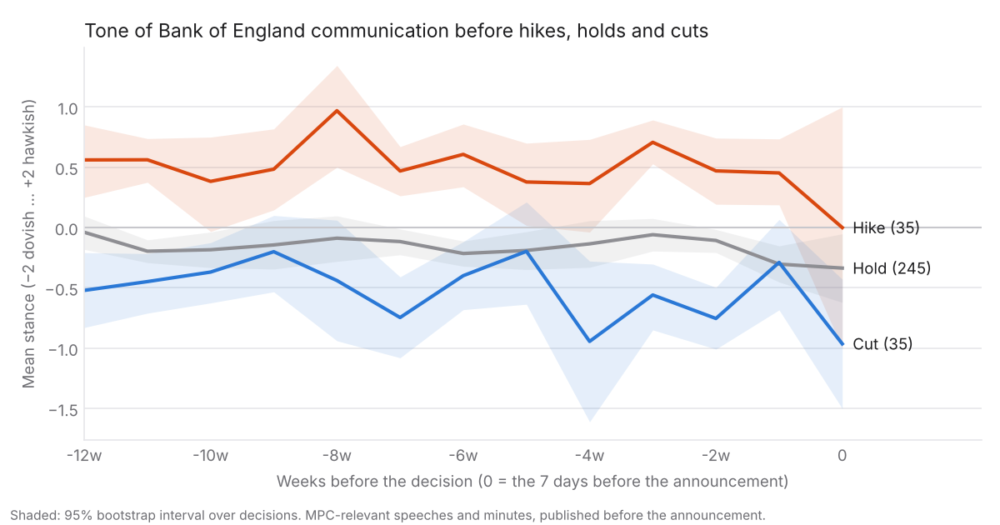

# hawk

Scoring 28 years of Bank of England speeches from hawkish to dovish, and testing whether tone predicted rate moves.

Hawk collects every Bank of England speech and every set of Monetary Policy Committee (MPC)
minutes since 1997, scores each one on a scale from −2 (very dovish) to +2 (very hawkish),
and asks a simple markets question: **did the tone of BoE communication shift before rate
decisions, and did 2-year gilt yields react to tone beyond what the decision itself
explains?** See [PLAN.md](PLAN.md) for the full plan.

**Website: <https://manoselvaks.github.io/hawk/>**

## Headline results

> From the AI scorer (`openai/gpt-6-luna`) over all 1,853 documents. Full write-up with
> methods, caveats and the same tests on word-list scores: [docs/findings.md](docs/findings.md).

- **Tone before hikes is clearly hawkish, before cuts clearly dovish** (+0.53 on a −2..+2
  scale in the 12 weeks before hikes, −0.12 before holds, −0.48 before cuts; hike minus
  cut +1.00, 95% CI +0.81 to +1.21). It does not build up in the final weeks before a hike.
- **Tone does not reliably help forecast the committee's next decision.** Out of sample,
  from 2003, adding tone to the previous decision improved log loss by +0.024 per meeting
  (95% CI −0.011 to +0.060). The 2-year gilt yield the day before forecasts far better.
- **2-year gilts did not move with speech tone**: +0.2 bp per stance point on 709 speech
  days (95% CI −0.2 to +0.6 bp), no different from random days.
- **But members' speeches do predict their own dissents.** Members who went on to vote for
  a higher rate than the majority had spoken at +1.08 on average, those voting lower at
  −0.86, the majority at −0.15 (p < 0.001; still clear after controlling for the member's
  previous vote). The word-list scorer missed this.
- **The AI scorer agrees with one student's 36 blind labels only modestly** (ρ = 0.37,
  95% CI 0.01–0.68), as does the word-list baseline (0.42); two AI models agree with each
  other at 0.96. See [docs/evaluation.md](docs/evaluation.md).



## Status

| Step | State |
| --- | --- |
| Speech and minutes collector | ✅ built (`src/hawk/speeches/`) |
| Market data (Bank Rate, gilt yields, MPC votes) | ✅ built (`src/hawk/market/`) |
| Tone scoring (word list + LLM) | ✅ built, evaluated and run on the full corpus (`src/hawk/scoring/`, `data/scores.parquet`) |
| Hand labels for evaluation | ✅ 36 blind labels (`labelling/labels.csv`) |
| Analysis | ✅ built, tested and run on the AI scores (`src/hawk/analysis/`, [docs/findings.md](docs/findings.md)) |
| Website | ✅ built on the final scores (`src/hawk/site/`) |

## Install

Requires Python 3.11 or newer.

```bash
git clone https://github.com/manoselvaks/hawk.git
cd hawk
python -m venv .venv && source .venv/bin/activate
pip install -e ".[dev]"
```

## Collect the speeches and minutes

```bash
python -m hawk.speeches.collect                                  # full rebuild
python -m hawk.speeches.collect --limit-speeches 20 --limit-minutes 10   # quick smoke run
```

(or `make collect` / `make collect-sample`). This writes `data/speeches.parquet` and
`data/minutes.parquet` (1,544 speeches and 315 sets of minutes in the committed build);
see [data/README.md](data/README.md) for the fields, per-year counts and known gaps.

The collector is built to be a good citizen of the BoE website:

- it identifies itself with a `User-Agent` that links back to this repository;
- it reads `robots.txt` first, obeys it (including any `Crawl-delay`), and discovers pages
  from the sitemaps listed there;
- it waits at least one second between requests (`--min-interval` to slow it further);
- every download is cached in `data/raw/` (gitignored), so an interrupted run can simply be
  restarted and will pick up where it left off without re-downloading anything.

Older speeches and minutes are often short web pages that link to a PDF; when a page has
little text and links to a PDF, the PDF's text is used instead.

## Score tone

Each document gets a **relevance** (0–1: is it about monetary policy?) and a **stance**
(−2 very dovish to +2 very hawkish), from two scorers: a transparent word-list baseline
and an LLM through OpenRouter. See [docs/methodology.md](docs/methodology.md) for the
design, and [docs/pilot.md](docs/pilot.md) for the model comparison.

```bash
python -m hawk.scoring.pilot                       # compare candidate models on 20 documents
python -m hawk.scoring.make_labelling_set          # build labelling/label.html
python -m hawk.scoring.evaluate --labels labelling/labels.csv --model MODEL   # one model vs hand labels
python -m hawk.scoring.compare --labels labelling/labels.csv --models M1 M2 M3  # compare, choose (no API)
python -m hawk.scoring.score_all                   # prints the cost estimate; --confirm to run
```

## Analysis

```bash
python -m hawk.analysis.run                     # on data/scores.parquet
python -m hawk.analysis.run --scorer baseline   # on word-list scores, no API needed
```

Builds the meeting-level dataset (tone from documents published strictly before each
decision, never that meeting's own minutes), then runs the event study, the
out-of-sample prediction test, the gilt market-reaction test and the dissent test. Writes
`data/analysis/findings.json` for the site, `findings_detail.json` and the charts in
`docs/img/`. See [docs/findings.md](docs/findings.md).

LLM calls are cached in `data/llm_cache/` and every call's cost is logged in
`data/llm_spend.jsonl`; the scorer refuses to run past a spend cap ($4 by default,
`--spend-cap` or `HAWK_SPEND_CAP_USD` to change). Set `OPENROUTER_API_KEY` to run
locally.

## Website

A static site (home chart, speech explorer, MPC member pages, findings, methodology)
built from the data files with Jinja templates, plain CSS and [uPlot](https://github.com/leeoniya/uPlot):

```bash
make site                      # or: python -m hawk.site.build  -> site/_build/
python -m hawk.site.serve      # build and preview on http://localhost:8000
make screenshots               # docs/screenshots/ (needs Node + Playwright)
```

Until `data/scores.parquet` exists the site is built with demo scores and says
"Preview" on every page. The files it reads are specified in
[docs/data-contract.md](docs/data-contract.md). The **Website** workflow
(`.github/workflows/pages.yml`) deploys it to GitHub Pages on every push to `main`.


## Development

```bash
make check   # ruff (lint + format), mypy (strict) and pytest
```

Tests run fully offline against trimmed copies of real BoE pages, a sitemap excerpt and
the first pages of two real PDFs, in `tests/speeches/fixtures/`.
CI runs the same checks on every push and pull request.

## Licence

MIT, see [LICENSE](LICENSE).
