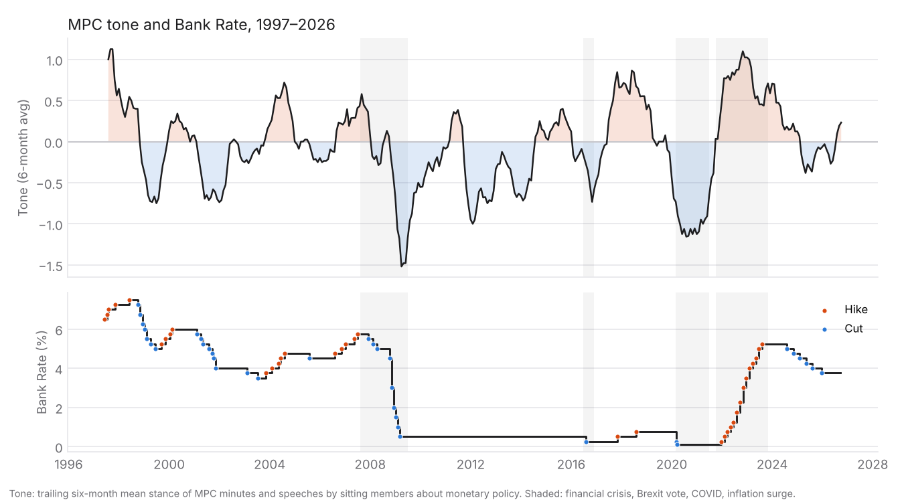
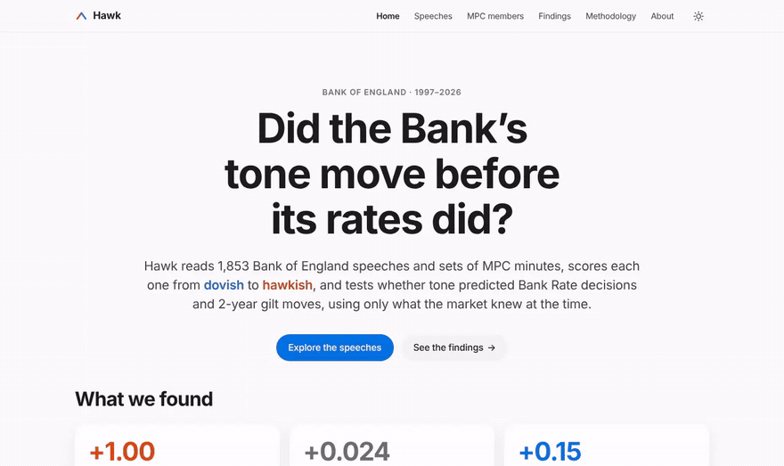
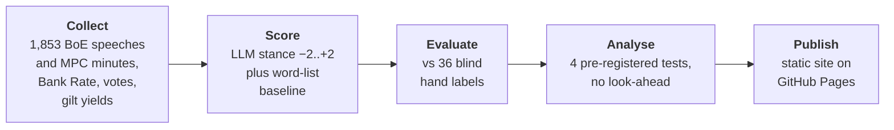

# Hawk

**Scoring 28 years of Bank of England speeches from dovish to hawkish, and testing whether tone moved before rates did.**

[](https://github.com/manoselvaks/hawk/actions/workflows/ci.yml)
[](https://github.com/manoselvaks/hawk/actions/workflows/pages.yml)
[](LICENSE)
[](pyproject.toml)

### 👉 [Live site: manoselvaks.github.io/hawk](https://manoselvaks.github.io/hawk/)



Hawk collects all 1,853 Bank of England speeches and sets of Monetary Policy Committee
(MPC) minutes published since 1997. It uses a language model to score each one from −2
(very dovish) to +2 (very hawkish), then tests the scores against Bank Rate decisions,
MPC votes and 2-year gilt yields. Every test uses only documents published before the
date it is about.

## Key findings

- **Tone was clearly more hawkish before hikes than before cuts:** **+1.00** on the −2 to
  +2 scale in the 12 weeks before a decision (95% CI +0.81 to +1.21). This result passes
  the multiple-testing threshold.
- **But tone didn't beat the market at predicting decisions.** Adding tone to the previous
  decision improved out-of-sample log loss by only **+0.024** per meeting (95% CI −0.011
  to +0.060, p = 0.09). The 2-year gilt yield already prices it in.
- **2-year gilts didn't react to speech tone:** **+0.21 bp** per stance point over 709
  speech days (95% CI −0.23 to +0.65). Random days produce slopes that large.
- **MPC members' speeches predicted their own dissenting votes:** **+0.152** per point of
  tone (p < 0.001). The effect is still **+0.078** (p < 0.001) after controlling for the
  member's previous vote.

> **How good is the AI?** It agrees only modestly with my 36 blind hand labels
> (Spearman ρ = 0.37, 95% CI 0.01–0.68). Two different AI models agree with each other at
> 0.96. See [docs/evaluation.md](docs/evaluation.md).

Full write-up with methods, tables and caveats: [docs/findings.md](docs/findings.md).



## How it works



1. **Collect** ([`hawk.speeches`](src/hawk/speeches), [`hawk.market`](src/hawk/market)):
   the collector reads `robots.txt`, rate-limits its requests and caches every download.
   Market data comes from the Bank's own series.
2. **Score** ([`hawk.scoring`](src/hawk/scoring)): each document gets a relevance score
   (is it about monetary policy?) and a stance. The model scores it with the speaker and
   date hidden. Calls are cached and capped by spend; the full corpus cost $0.59.
3. **Evaluate**: three models and the baseline are compared against blind hand labels,
   and a fixed rule chooses the production model
   ([docs/evaluation.md](docs/evaluation.md)).
4. **Analyse** ([`hawk.analysis`](src/hawk/analysis)): an event study, an out-of-sample
   ordered logit, gilt regressions with a placebo test, and a dissent regression. Four
   primary tests were fixed in advance, with a Bonferroni threshold of p < 0.0125.
5. **Publish** ([`hawk.site`](src/hawk/site)): a static site with Jinja templates, plain
   CSS and uPlot. It is rebuilt and deployed on every push to `main`.

## Tech stack

| Area | Tools |
| --- | --- |
| Language | Python 3.11+ |
| Data | pandas, pyarrow (Parquet), requests, BeautifulSoup, lxml, pypdf |
| Statistics | statsmodels (ordered logit, Newey-West, clustered SEs), SciPy, bootstrap CIs |
| AI scoring | LLMs through the OpenRouter API, with a cached and budget-capped client |
| Website | Jinja2, Markdown, uPlot, plain CSS/JS, GitHub Pages |
| Quality | pytest (offline fixtures), mypy `--strict`, ruff, GitHub Actions, Lighthouse |

## Reproduce it

Everything below runs offline from the committed data. No API key is needed unless you
re-score.

```bash
git clone https://github.com/manoselvaks/hawk.git
cd hawk
python -m venv .venv && source .venv/bin/activate
pip install -e ".[dev]"

make check                          # ruff, mypy --strict, pytest
python -m hawk.analysis.run         # re-run every test on data/scores.parquet
python -m hawk.site.serve           # build the site and open http://localhost:8000
```

Optional steps:

```bash
python -m hawk.speeches.collect     # re-collect the corpus (about 1 hour, polite rate limit)
python -m hawk.market.collect       # refresh Bank Rate, votes and gilt yields
export OPENROUTER_API_KEY=...       # then re-score (prints the cost first)
python -m hawk.scoring.score_all --confirm
make screenshots                    # docs/screenshots/ (needs Node and Playwright)
```

## Repo structure

```text
hawk/
├── src/hawk/
│   ├── speeches/      # BoE speech and minutes collector
│   ├── market/        # Bank Rate, MPC votes, gilt yields
│   ├── scoring/       # word-list baseline, LLM scorer, labelling and evaluation
│   ├── analysis/      # event study, prediction, market and dissent tests, charts
│   └── site/          # static website (templates, CSS, JS)
├── data/              # corpus, scores, market data and analysis outputs (committed)
├── labelling/         # blind labelling tool and the 36 hand labels
├── docs/              # findings, methodology, evaluation, data contract, images
├── tests/             # offline tests with real BoE page fixtures
└── scripts/           # screenshot helper
```

More detail: [methodology](docs/methodology.md), [data contract](docs/data-contract.md),
[data notes](data/README.md), [changelog](docs/CHANGELOG.md).

## Limitations

- **Small samples.** There are 315 decisions, about 70 of which are rate changes, and 36
  hand labels. "No evidence" means "no effect large enough to see", not "no effect".
- **One labeller.** The AI's agreement with the labels is modest, and the labels are one
  student's reading.
- **The model knows history.** Hiding the speaker and date reduces the risk that the
  model recognises a speech and knows what happened next, but cannot remove it. This
  matters most for the dissent result.
- **Daily data.** Yields are end-of-day closes, speech times are unknown and same-day data
  releases are not controlled for.
- **Correlation, not causation.** Tone and decisions both respond to the same economic news.

## Author

Built by **Manoj**, a finance student in London interested in markets and macro.

- GitHub: [@manoselvaks](https://github.com/manoselvaks)
<!-- TODO(Manoj): add your LinkedIn, e.g.
- LinkedIn: [Manoj](https://www.linkedin.com/in/your-profile/)
-->

If you use Hawk, please cite it ([CITATION.cff](CITATION.cff)). Not affiliated with the
Bank of England. Code under the [MIT licence](LICENSE).
