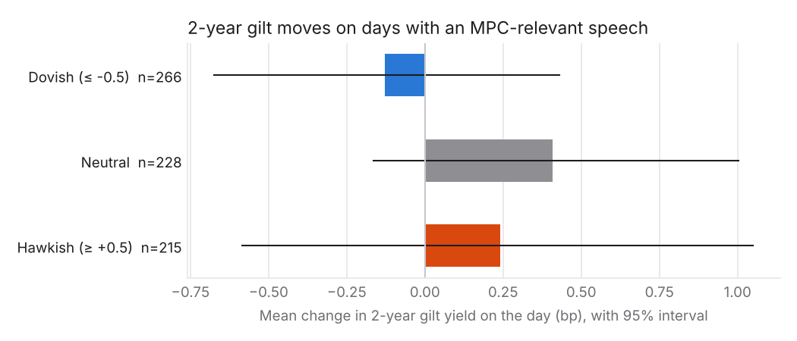

# Findings

**Question:** did the tone of Bank of England speeches and MPC minutes shift *before* Bank
Rate decisions, and did 2-year gilt yields react to tone beyond what the decisions
themselves explain? Every test uses only documents published before the date it is
about. All numbers come from the AI scorer (`openai/gpt-6-luna`, prompt `stance_v1`, full
text) run over the whole corpus; the same tests on the word-list baseline are in
[Robustness: AI vs word lists](#robustness-ai-vs-word-lists).

## The short version

- **Tone separates hikes from cuts clearly.** In the 12 weeks before the 35 hikes,
  average tone was +0.53 on the −2 to +2 scale, against −0.12 before the 245 holds and
  −0.48 before the 35 cuts (hike minus cut: +1.00, 95% interval +0.81 to +1.21). Before
  hikes tone did not *build up* in the final weeks: it was already there three months
  earlier. Before cuts it fell a little further in the last month (−0.20, interval −0.40
  to −0.00, only just excluding zero).
- **Tone does not reliably help forecast the next decision once you know the last one.**
  Re-fitted before each of 244 meetings using only earlier data, adding tone to the
  previous decision improved log loss by +0.024 per meeting (95% interval −0.011 to
  +0.060; p = 0.09). Pointing the right way, but not distinguishable from zero. The
  2-year gilt yield the day before is a far better forecaster; tone adds +0.036 to it
  (−0.017 to +0.091), also not reliable.
- **2-year gilts did not move with speech tone.** On 709 days with an MPC-relevant speech
  (announcement and minutes days left out), a speech one point more hawkish went with a
  +0.2 bp move in the 2-year yield (95% interval −0.2 to +0.6 bp). Random non-speech days
  give slopes this large a quarter of the time. A typical day's move is about 3 bp.
- **Members' own speeches do predict their own dissents.** Members who went on to vote for
  a higher rate than the majority had given speeches averaging +1.08; those who voted with
  the majority −0.15; those who voted for a lower rate −0.86. The slope is +0.15 per point
  (95% interval +0.10 to +0.21, p < 0.001). About half of it is persistence (the same
  people dissent again), but tone still matters after controlling for the member's
  previous vote (+0.08, p < 0.001).
- **The sample is small.** About 315 decisions, 70 of them rate changes, 36 hand labels.
  "No evidence" here means "no effect large enough to see in this sample", not "no effect".

Four tests were fixed in advance as the primary ones (one per question above). With four
tests a result needs p < 0.0125 (0.05 / 4, Bonferroni) to count. **Two pass: the
event-study difference and the dissent slope.** The prediction and market tests are null;
everything else on this page is a robustness check or description.

## Data and scores

- **Documents:** 1,853 (1,539 speeches, 314 sets of minutes) published from February 1997
  to October 2026, all scored by the AI; none skipped. The AI counts **1,086** of them as
  about monetary policy (relevance ≥ 0.5); only those are used. (The word-list scorer
  counts 1,019; the two agree on 1,001.)
- **Decisions:** 315 MPC Bank Rate decisions, June 1997 to September 2026: 34 hikes after
  the first meeting, 35 cuts, 245 holds (plus the first decision, which has no
  "previous decision").
- **Gilts:** 2-year nominal spot yield from the Bank's fitted curve, business-day closes.
- **Scorer:** each document's full text (or, for the 955 documents over 24,000 characters,
  24,000 characters of keyword-selected policy passages) with the speaker and date hidden;
  the model returns relevance, stance from −2 to +2 in half points, confidence and a
  one-sentence reason ([methodology](methodology.md)). Its agreement with 36 hand labels
  is modest (Spearman ρ 0.37; [evaluation.md](evaluation.md)).

### The no-look-ahead rule

For the decision announced on day *D*, a document counts only if its `published_date` is
strictly before *D*, and the minutes of that same meeting never count (since August 2015
they are published at the same moment as the decision). Minutes published two weeks after
an *earlier* meeting are fine: the market had them. The rule lives in
`hawk.analysis.dataset.window_documents`, and `tests/analysis/test_dataset.py` checks it
directly, including that adding documents published on or after an announcement never
changes that decision's features.

### Meeting-level features

For each decision: mean stance of relevant documents published since the previous
decision (`tone`), its change from the previous window (`tone_change`), the same from MPC
documents only (minutes plus speeches by sitting members), and a version weighted by
relevance × confidence. 314 of 315 windows contain at least one relevant document
(median 3).

## 1. Event study: tone before hikes, holds and cuts


Week 0 is the seven days before the announcement; week −12 is twelve weeks earlier. For
each decision, each week's tone is the mean stance of relevant documents published that
week; the line is the mean across decisions of that type, and the band a 95% bootstrap
interval over decisions. Windows of neighbouring meetings overlap (the MPC meets every
four to six weeks), so the weeks are not independent observations. Few documents appear
in the week before an announcement (the MPC's quiet period), so week 0 is noisy: note the
wide bands there.

| next decision | events | mean tone, 12 weeks before | 95% interval | change, last 4 weeks vs first 4 | 95% interval |
| --- | ---: | ---: | --- | ---: | --- |
| Hike | 35 | +0.53 | +0.41 to +0.65 | +0.02 | −0.19 to +0.24 |
| Hold | 245 | −0.12 | −0.19 to −0.06 | +0.02 | −0.07 to +0.10 |
| Cut | 35 | −0.48 | −0.65 to −0.32 | −0.20 | −0.40 to −0.00 |

**Primary test:** pre-decision tone before hikes minus before cuts = **+1.00** (95%
interval +0.81 to +1.21). Using MPC documents only gives the same picture (+0.54, −0.12,
−0.48).

What this does and does not say. Hikes come in runs during hawkish periods (1997–98,
2004–07, 2021–23), and the tone of those periods is hawkish throughout, so the level of
tone mostly identifies the *regime*, not the timing of the next move. The flat line before
hikes is the more telling result: there is no visible "pivot" in tone in the month before
a hike. Before cuts there is a small further fall, consistent with the Bank preparing the
ground for easing (and with the emergency cuts of 2001, 2008 and 2020 following sudden
bad news), but its interval only just excludes zero. Holds sit in between, closer to
neutral; most holds since 2009 happened at or near the zero lower bound.

## 2. Prediction test: does tone add information?

Outcome: the decision (cut, hold, hike) at each **scheduled** meeting from January 2003 to
September 2026 (244 meetings; the four emergency cuts are left out because their timing
gives the answer away, but they still count as "the previous decision" for the meeting
after). Models are ordered logits, re-estimated before every meeting on the decisions
announced before it. Accuracy, log loss and Brier score are all **out of sample**;
pseudo-R² is in sample.

| model | accuracy | log loss | Brier | accuracy on rate changes (44) | log loss on changes | pseudo-R² (in sample) |
| --- | ---: | ---: | ---: | ---: | ---: | ---: |
| Always hold (rule) | 82.0% | – | 0.361 | 0% | – | – |
| Same as last time (rule) | 78.7% | – | 0.426 | 43% | – | – |
| Previous decision | 80.7% | 0.527 | 0.286 | 0% | 1.758 | 0.147 |
| Previous decision + tone | 82.4% | 0.503 | 0.283 | 20% | 1.534 | 0.207 |
| Previous decision + market | 84.0% | 0.431 | 0.253 | 25% | 1.429 | 0.310 |
| Previous decision + market + tone | 84.4% | 0.395 | 0.236 | 45% | 1.121 | 0.412 |

"Market" is the 2-year gilt yield minus Bank Rate at the close before the announcement,
and its change since the previous meeting: what the market expected. Log loss is the
fairer score: accuracy rewards always saying "hold", which is right 82% of the time and
useless. Rules give no probabilities, so they have no log loss.

**Primary test:** mean per-meeting log-loss gain from adding tone to the previous decision
= **+0.024** (95% bootstrap interval −0.011 to +0.060; one-sided p = 0.09). Not a
reliable gain at the pre-set threshold. Adding tone to the market model: +0.036 (−0.017
to +0.091; p = 0.09). Robustness, same benchmark: MPC documents only +0.023 (−0.014 to
+0.060); weighted by relevance × confidence +0.024 (−0.012 to +0.061); tone change only
−0.003 (−0.008 to +0.002).

In-sample coefficients (whole period, ordered logit; positive = more likely to hike):

| term | estimate | std. error | p |
| --- | ---: | ---: | ---: |
| Previous decision: cut | −1.11 | 0.46 | 0.016 |
| Previous decision: hike | +1.74 | 0.45 | <0.001 |
| Tone since last meeting | +1.48 | 0.30 | <0.001 |
| Change in tone vs previous window | −0.81 | 0.30 | 0.007 |

Why tone is strongly "significant" in sample but not reliably useful out of sample: over
the whole period tone level and decisions share the same slow regimes, which a
full-sample fit exploits with hindsight. A forecaster standing at each meeting has to
learn the relationship from the past alone, and the regime shifts (to the zero bound in
2009, out of it in 2021) are exactly when that fails. The out-of-sample numbers are the
honest ones. The hint worth following up: on the 44 rate changes, tone helps both
alone (9 called correctly against 0) and on top of the market variables (log loss
1.43 → 1.12; 11 → 20 called correctly), but that is a subgroup of a non-significant
overall result.

## 3. Market reaction: do 2-year gilts listen?



Unit: business days, 1997–2026, excluding the 533 days with an MPC announcement or a
minutes publication. A speech day has at least one relevant speech published that day
(weekend publications move to the next business day); its stance is the mean of those
speeches. The move is close-to-close in basis points.

| days | n | mean absolute 2y move (bp) | 95% interval |
| --- | ---: | ---: | --- |
| No relevant speech | 6,284 | 3.17 | 3.09 to 3.25 |
| Speech by an MPC member | 682 | 3.41 | 3.15 to 3.70 |
| Speech by a non-member | 27 | 3.31 | 2.12 to 4.55 |

Regressions of the move on stance (Newey-West standard errors, 5 lags):

| specification | n | bp per stance point | 95% interval | p |
| --- | ---: | ---: | --- | ---: |
| **Stance (primary)** | 709 | +0.21 | −0.23 to +0.65 | 0.35 |
| Stance surprise (vs. last 60 days) | 707 | +0.06 | −0.36 to +0.48 | 0.77 |
| Stance, two-day move (t−1 to t+1) | 661 | +0.62 | −0.01 to +1.26 | 0.06 |
| Stance, MPC members only | 682 | +0.20 | −0.23 to +0.63 | 0.37 |
| Stance, non-members only | 27 | +1.45 | −1.57 to +4.47 | 0.35 |

By era (stance): pre-2008 +0.14 (p = 0.74), 2008–15 +0.26 (p = 0.35), 2016–21 +0.25
(p = 0.42), 2022+ −0.39 (p = 0.61). Moving the relevance cut-off to 0.3 or 0.8 gives
+0.23 (p = 0.30) and +0.14 (p = 0.55).

**Placebo.** Giving the real speech-day stances to randomly drawn non-speech days (1,000
times) produces slopes at least as large as the real one 26% of the time, so the primary
slope is what chance alone produces. For stance surprise the share is 75%. The two-day
move is the closest to a signal (+0.6 bp per point, p = 0.06), which would fit speeches
given after the close, but it is a robustness check and does not reach the threshold.

Limits of this test: yields are end-of-day and speech times unknown, so an after-hours
speech registers a day late (hence the two-day check); data releases (CPI, labour market,
GDP) on the same day are not controlled for, because Hawk has no release calendar.

## 4. Does a member's tone predict their own dissent?

For each decision and each voting member with at least one relevant speech since the
previous decision (677 member-meetings, 48 members, 83 dissents):

| vote at the next meeting | member-meetings | mean tone of their speeches |
| --- | ---: | ---: |
| For a higher rate than agreed | 43 | +1.08 |
| With the majority | 594 | −0.15 |
| For a lower rate than agreed | 40 | −0.86 |

Linear regression of the vote (+1 higher, 0 with majority, −1 lower) on tone, standard
errors clustered by member: **+0.152 per point** (95% interval +0.096 to +0.209,
p < 0.001). This passes the Bonferroni threshold comfortably, and the pattern is
symmetric: upward dissenters sound hawkish, downward dissenters dovish.

Is this just the same people dissenting again? Partly. Dissent is persistent (Dhingra dissented
21 times, Blanchflower and Mann 18 each, Buiter, Nickell, Sentance and McCafferty 17), and a
member's speeches may simply restate a position the market already knows from the
previous vote. Controlling for the member's own vote at the previous decision (a
robustness check added after seeing the primary result) halves the tone slope, to
**+0.078** (+0.037 to +0.119, p < 0.001), but it stays clearly positive. So speeches carry
some information about an upcoming dissent beyond the member's voting record, though a
smaller amount than the raw slope suggests.

Two cautions. The model saw the speeches without speaker names, but may still recognise a
famous speech and know how its author voted. And this is about *individual* votes: the
committee's decision is a different question, and there (section 2) tone does not
reliably help.

## Robustness: AI vs word lists

The same primary tests on the transparent word-list baseline (Apel and Blix Grimaldi's
net index, run on the same corpus; [`data/analysis/baseline/findings_detail.json`](../data/analysis/baseline/findings_detail.json)).
The word-list scale is compressed (it rarely goes beyond ±1.5), so compare signs and
significance, not sizes. Across the 1,001 documents both call relevant, the two scorers'
stances correlate only moderately (Spearman 0.41).

| test | AI scorer | word lists | same conclusion? |
| --- | --- | --- | --- |
| Event study: hike minus cut | **+1.00** (+0.81 to +1.21) | **+0.65** (+0.52 to +0.79) | Yes: both clearly positive |
| …tone before hike / hold / cut | +0.53 / −0.12 / −0.48 | +0.43 / −0.21 / −0.23 | Partly: with word lists, holds and cuts look alike |
| …change in last 4 weeks before cuts | −0.20 (−0.40 to −0.00) | −0.09 (−0.28 to +0.08) | Partly: only the AI shows a small late fall |
| Prediction: log-loss gain from tone | +0.024 (−0.011 to +0.060), p = 0.09 | +0.004 (−0.030 to +0.036), p = 0.40 | Yes: both null (AI closer to a gain) |
| …tone on top of market | +0.036 (−0.017 to +0.091), p = 0.09 | +0.025 (−0.027 to +0.079), p = 0.17 | Yes: both null |
| Market: bp per stance point | +0.21 (−0.23 to +0.65), p = 0.35 | −0.21 (−0.86 to +0.43), p = 0.52 | Yes: both null (sign differs) |
| …stance surprise | +0.06, placebo share 75% | −0.56, placebo share 3% | **No**: the word lists' wrong-sign "surprise" effect disappears |
| Dissent: slope on own tone | **+0.152** (+0.096 to +0.209), p < 0.001 | +0.042 (−0.009 to +0.093), p = 0.11 | **No**: significant with the AI, not with word lists |
| …controlling for previous vote | +0.078, p < 0.001 | +0.024, p = 0.19 | **No** |

**What changed from the earlier word-list write-up.** The dissent conclusion changes: the
word lists found a weak, non-significant link (upward dissenters sounded hawkish but
downward dissenters did not sound dovish); the AI scores find a strong, symmetric one that
survives the multiple-testing threshold. The negative "stance surprise" slope the word
lists produced, flagged then as likely noise, does not appear with the AI scores. The
event-study gap is larger with the AI, holds now sit between hikes and cuts rather than
looking like cuts, and cuts show a small late fall in tone. The prediction and market
conclusions do not change: both are null with either scorer.

A plausible reason the AI does better on dissent in particular: a dissenter's speech
usually argues a case ("the risks to inflation are to the upside, so…"), which the AI
reads as a lean on policy, while the word lists count phrases such as "inflation
pressures" that hawks and doves both use when describing the same data.

## Limitations

- **Small samples.** 315 decisions, about 70 of them changes, 244 out-of-sample meetings
  with 44 changes. A real but modest effect of tone could easily go undetected.
- **Multiple testing.** Four primary tests at p < 0.0125. The tables also show subgroups
  and robustness checks (about 20 more p-values); some will look "significant" by chance.
- **One labeller, 36 labels.** The scorer evaluation is coarse ([evaluation.md](evaluation.md)):
  the AI's agreement with the labels is modest (ρ 0.37), and two different AI models agree
  with each other far more than with the labels.
- **Look-ahead through the model.** The model was trained on text written after most of
  these speeches. Hiding the speaker and date reduces, but cannot remove, the risk that it
  recognises a speech and knows what happened next. This matters most for the dissent test.
- **Daily data.** End-of-day yields, unknown speech times, no data-release controls.
- **Correlation, not causation.** Tone and decisions both respond to the same economic
  news.

## Reproduce

```bash
python -m hawk.analysis.run                     # on data/scores.parquet (AI scores)
python -m hawk.analysis.run --scorer baseline \
    --out-dir data/analysis/baseline --img-dir /tmp/hawk-baseline-img   # word lists
```

This writes `data/analysis/findings.json` (the website), `data/analysis/findings_detail.json`
(every number on this page, plus robustness checks) and the charts in `docs/img/`. Code:
`src/hawk/analysis/`; tests: `tests/analysis/`.
